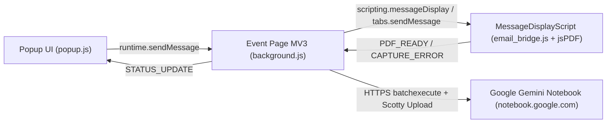

# ARCHITECTURE.md — Magic Clipper for Gemini Notebook (Thunderbird)

Ce document constitue la source unique de vérité technique décrivant l'architecture interne, les composants et les flux de données de **Magic Clipper for Gemini Notebook** pour Thunderbird (`v1.6.0+`, Manifest V3).

---

## 1. Vue d'Ensemble

**Magic Clipper for Gemini Notebook** est une **MailExtension Thunderbird Manifest V3** ciblant **Thunderbird 128.0+ ESR**. Elle permet d'importer le contenu d'un courriel affiché (corps et/ou pièces jointes) directement dans un carnet **Google Gemini Notebook** (`https://notebook.google.com`) en un clic depuis la barre d'outils du panneau de lecture (`message_display_action`).

### Stack technique
- **JavaScript Vanilla (ES2021)** : zéro framework, zéro bundler applicatif, code lisible non minifié auditable par ATN.
- **jsPDF 4.2.1** (`lib/jspdf.umd.min.js`) : bibliothèque officielle non modifiée (déclarée dans `VENDOR.md`), utilisée pour le rendu PDF côté client.
- **Manifest V3 Thunderbird (`strict_min_version: "128.0"`)** : Event Page non persistante pilotée par événements (`runtime.onInstalled`, `runtime.onStartup`, `alarms.onAlarm`, `tabs.onUpdated`, `downloads.onChanged`) et état éphémère dans `browser.storage.session`.
- **Internationalisation native WebExtension (`_locales/`)** : 7 langues synchronisées (`en`, `fr`, `de`, `es`, `vi`, `ja`, `pt`).

---

## 2. Architecture Globale et Flux de Données



---

## 3. Arborescence du Projet

```text
mc4nblm-thunderbird/
├── manifest.json                    # Manifest V3, message_display_action, Thunderbird 128.0+
├── VENDOR.md                        # Déclaration officielle des bibliothèques tierces (jsPDF 4.2.1)
├── PRIVACY-POLICY.md                # Charte de confidentialité publique
├── CONTRIBUTING.md                  # Standards d'ingénierie, sécurité DOM/CSP et build
├── _locales/                        # Traductions natives (en, fr, de, es, vi, ja, pt — 82 clés)
├── icons/                           # Icônes 16x16, 32x32, 48x48, 64x64 (@2x), 128x128 et SVG source
├── lib/
│   └── jspdf.umd.min.js             # jsPDF 4.2.1 officiel non modifié
└── src/
    ├── shared/
    │   └── utils.js                 # Utilitaires partagés, i18n t(), htmlToMarkdown(), sanitizeFilename()
    ├── background/
    │   ├── background.js            # Event Page MV3 : routeur IPC cloisonné et 3 pipelines d'import
    │   └── api/
    │       ├── auth.js              # Cookies Gecko TB, RotateCookies via browser.alarms, jeton SNlM0e
    │       └── rpc_client.js        # Protocole batchexecute LabsTailwindUi + upload resumable Scotty
    ├── content/
    │   ├── email_bridge.js          # MessageDisplayScript : relais isolé PING_BRIDGE / CAPTURE_EMAIL_PDF
    │   └── email_pdf_generator.js   # Custom DOM Walker jsPDF paginé ligne à ligne
    └── popup/
        ├── pre_loader.js            # Intercepteur précoce des erreurs critiques de chargement
        ├── popup.html               # Interface 6 états accessible WCAG 2.1 AA + opt-in ATN
        ├── popup.css                # Système de design Glassmorphism sombre/clair (color-scheme)
        └── popup.js                 # Orchestration réactive, Fast Research, KeepAlive MV3
```

---

## 4. Responsabilités des Composants

### 4.1 `manifest.json` (Manifest V3)

| Clé | Valeur | Rôle |
|---|---|---|
| `manifest_version` | `3` | Architecture Event Page MV3 pour Thunderbird 128+ ESR |
| `browser_specific_settings.gecko.strict_min_version` | `"128.0"` | Support natif MV3, `scripting.messageDisplay` et `getDisplayedMessages` |
| `data_collection_permissions.required` | `["personalCommunications"]` | Déclaration transparente de transmission sur action explicite |
| `message_display_action` | `src/popup/popup.html` | Bouton intégré à l'en-tête du courriel affiché (`default_label`: `"Notebook"`, `default_title`: `"Clipper vers Gemini Notebook"`) |
| `permissions` | `messagesRead`, `storage`, `cookies`, `downloads`, `scripting`, `alarms`, `sensitiveDataUpload` | Permissions minimales strictement nécessaires |
| `host_permissions` | `https://*.google.com/*`, `https://*.googleapis.com/*` | Communications chiffrées HTTPS exclusives |
| `content_security_policy.extension_pages` | `script-src 'self'; object-src 'none';` | Politique CSP MV3 stricte (zéro script inline, zéro `eval`) |

### 4.2 `src/background/background.js` (Event Page MV3)
- **Cycle de vie non persistant** : tous les écouteurs d'événements (`runtime.onInstalled`, `runtime.onStartup`, `alarms.onAlarm`, `downloads.onChanged`, `runtime.onMessage`) sont enregistrés de manière synchrone au top-level.
- **Cloisonnement IPC strict** : vérifie `sender.id === browser.runtime.id` et sépare hermétiquement les messages issus d'un onglet email (`sender.tab` : `PDF_READY`, `CAPTURE_ERROR`) des actions de pilotage réservées à la popup (`!sender.tab`).
- **Résolution universelle du message actif** : utilise `messenger.tabs.query({ active: true, currentWindow: true })` combiné à l'API MV3 `messenger.messageDisplay.getDisplayedMessages(tab.id)` (compatible onglet 3-pane, onglet message dédié et fenêtre autonome).
- **Extraction MIME fidèle** : `extractEmailBodyFromFull()` parcourt récursivement `fullMessage.parts` (profondeur bornée à 20), gère les courriels mono-partie sans `parts[]` et exclut les pièces jointes MIME (`Content-Disposition: attachment` ou `part.name`). Les courriels sans texte mais dotés de pièces jointes supportées restent importables (`hasPdf: false, hasMd: false`).
- **Gestion mémoire des captures (`200 Mo` / `500 000 mots`)** : s'aligne à 100 % sur les quotas natifs de Gemini Notebook. Pendant l'upload et tant que l'écran de succès affiche le bouton de téléchargement local, la popup maintient l'Event Page active via un `PING` léger toutes les 20 s, complété par une purge immédiate à la fermeture de la popup (`PURGE_CAPTURE`) et une alarme `ntc-purge-capture` à 5 minutes.

### 4.3 `src/background/api/auth.js`
- **Consentement explicite ATN (`ntc_data_consent`)** : aucun appel réseau vers Google n'est autorisé tant que l'utilisateur n'a pas coché l'opt-in explicite lors de sa première connexion (révocable à tout moment via `DISCONNECT_AUTH`).
- **Collecte priorisée des cookies Gecko** : lit les cookies par URL (`https://notebook.google.com`, `https://accounts.google.com`, puis repli `https://notebooklm.google.com`) sans écraser les cookies spécifiques au domaine actif.
- **Rotation périodique MV3** : remplace `setInterval` par l'alarme `browser.alarms` (`ntc-rotate-cookies`, période de 9 minutes) et stocke l'horodatage de rotation ainsi que l'ID de l'onglet d'authentification dans `browser.storage.session`.
- **Validation stricte de connexion** : l'onglet WebContent d'authentification n'est fermé automatiquement qu'après confirmation effective de la présence du jeton CSRF `SNlM0e` sur `notebook.google.com`. Si l'utilisateur referme l'onglet manuellement, l'événement `auth_closed` ramène immédiatement la popup à l'écran initial.

### 4.4 `src/background/api/rpc_client.js`
- **Domaine et Endpoint** : cible `https://notebook.google.com/_/LabsTailwindUi/data/batchexecute` avec `source-path=/notebook/{notebookId}` pour les écritures de sources (`izAoDd`, `o4cbdc`) et `source-path=/` pour la gestion des carnets (`wXbhsf`, `CCqFvf`).
- **Décodeur anti-XSSI intact** : conserve la traduction fidèle de `parseChunkedResponse()` et `extractRpcResult()`, tout en rejetant explicitement toute page HTML de reconnexion ou réponse vide (`AUTH_EXPIRED` / `API_CHANGED`).
- **Protocole resumable Google Scotty (3 étapes)** : initialisation sur `https://notebook.google.com/upload/_/?authuser={index}`, vérification stricte du domaine de `x-goog-upload-url` (`upload.googleapis.com` / `notebook.google.com`), transfert binaire et vérification de `x-goog-upload-status: final`.

### 4.5 `src/content/email_pdf_generator.js` & `src/content/email_bridge.js`
- **Enregistrement 3 niveaux (TB 128+ MV3)** :
  1. Enregistrement déclaratif au démarrage via `messenger.scripting.messageDisplay.registerScripts()`.
  2. Rattrapage au démarrage des onglets `mail` / `messageDisplay` déjà ouverts via `messenger.scripting.executeScript()`.
  3. Injection à la demande dans `handlePdfCapture()` si `PING_BRIDGE` ne répond pas.
- **Pagination ligne par ligne** : `drawLinesPaginated()` contrôle le saut de page A4 avant chaque ligne individuelle sur l'ensemble des blocs (intention, grounding, titres, paragraphes, listes, citations, blocs `<pre>` et tableaux).
- **Conteneurs mixtes et images** : `renderInlineContainer()` traite uniformément les `<div>` et `<p>` imbriqués des courriels HTML modernes et préserve les images `` inline (aplaties sur fond blanc `#ffffff` avant export JPEG pour éviter les fonds noirs sur PNG transparents, puis libération immédiate du canvas).
- **Avertissement glyphes non latins** : détecte les caractères hors Latin-1 / CP1252 non couverts par la police standard Helvetica de jsPDF et remonte l'indicateur `hasNonLatinGlyphs` afin d'afficher un conseil non bloquant orientant vers l'export Markdown UTF-8.

### 4.6 `src/popup/` (`popup.html`, `popup.css`, `popup.js`, `pre_loader.js`)
- **Accessibilité WCAG 2.1 AA** : `color-scheme: dark / light`, contrastes vérifiés (`>= 4.5:1` texte, `>= 3:1` bordures et contrôles), gestion dynamique de `aria-busy`, `aria-expanded`, `aria-valuenow`/`aria-valuetext`, `aria-describedby` sur les pièces jointes, navigation clavier complète de la listbox des carnets et restauration logique du focus.
- **Barre de session supérieure (`.ready-header`)** : regroupe le sélecteur multi-comptes (`#account-section`) et le bouton de révocation (`#btn-disconnect`) tout en haut de `#state-ready` (au-dessus de `.email-meta`), à l'écart des boutons d'action d'importation tout en conservant le focus initial sur `#notebook-search`.
- **Résilience UX** : erreurs de validation affichées inline (`#ready-inline-error`) sans détruire la saisie en cours, timeout de sécurité réinitialisé à chaque progression d'import par lot (`resetCaptureTimeout()`), et aucune boîte de dialogue native bloquante (`alert`/`prompt`/`confirm`).

---

## 5. Décisions Architecturales Clés

| Sujet | Arbitrage retenu | Justification |
|---|---|---|
| Cible minimale | Thunderbird `128.0` ESR (MV3) | Élimine le code mort MV2 (`messageDisplayScripts.register` exigeant `messagesModify`) et adopte les APIs pérennes de TB 128+ |
| Quotas fichiers / mots | Quotas natifs Gemini Notebook (`200 Mo`, `500 000 mots`) | Aucune sous-limite artificielle : le KeepAlive de l'écran de succès maintient le buffer RAM disponible pour le téléchargement local |
| Consentement utilisateur | Case opt-in explicite au premier lancement (`ntc_data_consent`) | Conformité stricte avec la règle ATN `data-exfiltration` sans alourdir l'usage quotidien |
| Bibliothèque PDF | `jsPDF 4.2.1` officiel non modifié + `VENDOR.md` | Conformité `thunderbird/webext-linter` (`minified-code` / `find-lib-on-cdn`) sans patch binaire |
| Sécurité DOM | Zéro `innerHTML` / `outerHTML` / `eval` | Protection XSS et conformité CSP MV3 vérifiée automatiquement par ESLint |
